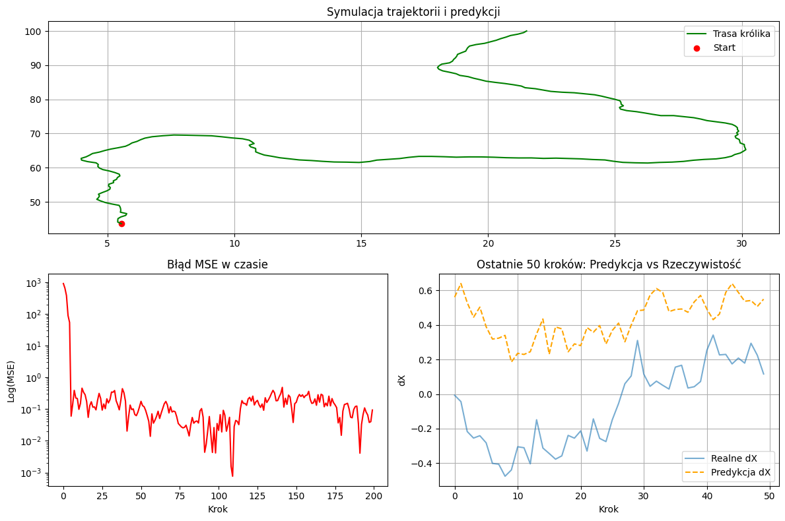

***

# MSE Trajectory Prediction: Wolf and Rabbit Simulation

***

Projekt badawczy realizowany w ramach przedmiotu Metody Optymalizacji. Celem projektu jest analiza zastosowania błędu średniokwadratowego (Mean Squared Error - MSE) jako funkcji straty w procesie uczenia sieci neuronowej do przewidywania trajektorii obiektów w dynamicznym, stochastycznym środowisku.

***

### Autorzy
- Marta Marcinkowska
- Jakub Wanat

***

## Opis projektu
Symulacja odwzorowuje dynamikę relacji drapieżnik-ofiara (pościg wilka za zającem). Królik porusza się w sposób stochastyczny z uwzględnieniem ograniczeń fizycznych (szum gaussowski, macierz obrotu 2D, ograniczenia prędkości i przyspieszenia). Wilk wykorzystuje perceptron wielowarstwowy (MLPRegressor) z mechanizmem uczenia przyrostowego (online learning), aby dostosować swoje decyzje w locie i skutecznie śledzić ofiarę.

Kluczowym elementem optymalizacji jest funkcja kosztu MSE:
$$MSE = \frac{1}{n} \sum_{i=1}^{n} (y_i - \hat{y}_i)^2$$

***

## Podejścia badawcze

W projekcie zaimplementowano i porównano dwa podejścia do predykcji trajektorii:

1. **Metoda 'pos' (Absolute Coordinates):**
   - Sieć uczy się mapowania historycznych współrzędnych przestrzennych na bezwzględną pozycję w kolejnym kroku $(x, y)$.
   - Podejście zależne od globalnego układu współrzędnych.

2. **Metoda 'delta' (Positional Increments):**
   - Sieć przewiduje wektory ruchu / przyrosty $(\Delta x, \Delta y)$ zamiast stałych położeń.
   - Podejście niezależne od początku układu współrzędnych, co zapewnia szybszą zbieżność, wyższą stabilność numeryczną oraz lepsze odwzorowanie dynamiki pościgu.

***

## Wizualizacja wyników (Dashboard symulacyjny)

Poniżej przedstawiono przykładowy raport generowany automatycznie podczas symulacji (wizualizacja trajektorii 2D, ewolucja błędu w skali logarytmicznej oraz porównanie realnych i przewidywanych przyrostów):



***

## Struktura projektu

- `actors.py` - definicje klas aktorów (Rabbit, Wolf) oraz generatora trajektorii z szumem gaussowskim i macierzą obrotu.
- `model.py` - konfiguracja modelu sieci neuronowej (`MLPRegressor` z trybem `warm_start=True`).
- `utils.py` - logika symulacji dla obu metod (`pos`, `delta`) oraz funkcja generująca raporty graficzne (`generate_report`).
- `simulation.ipynb` - główny notatnik Jupyter demonstrujący przebieg eksperymentu.
- `prezentacja_mse.pdf` - prezentacja projektowa przygotowana w formacie LaTeX Beamer.

***

## Technologie
- Język: Python 3.13
- Biblioteki ML: Scikit-learn, NumPy
- Wizualizacja: Matplotlib
- Narzędzia: uv (zarządzanie środowiskiem)

***

## Instalacja i uruchomienie

Dzięki zastosowaniu narzędzia `uv`, konfiguracja środowiska jest szybka i powtarzalna:

1. Zainstaluj `uv`:
```bash
   pip install uv
```
2. Sklonuj repozytorium:
```bash
    git clone https://github.com/jawanat/mse-trajectory-prediction.git
```
3. Pobierz wirtualne środowisko wraz z wykorzystywanymi bibliotekami:
```bash
    uv sync
```
***